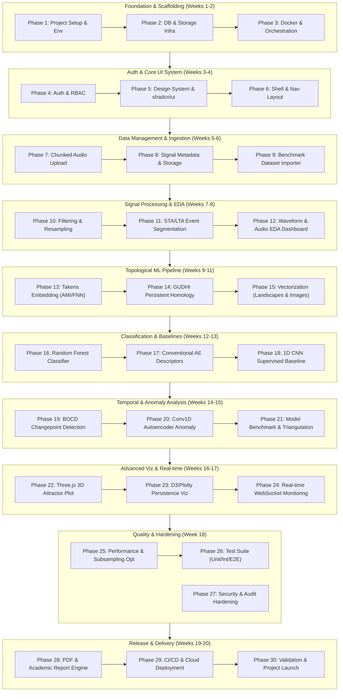

# 🗺️ EchoSense: 30-Phase Master Implementation Plan

## Executive Summary & Timeline Roadmap

This document outlines the **30-Phase Engineering & Research Roadmap** for **EchoSense** — a full-stack topological machine learning framework for detecting structural damage precursors from smartphone acoustic emission (AE) signals.

The timeline spans **18 to 20 weeks** (totaling ~90 business days across the engineering and research team).

---

## 📅 Roadmap & Milestones Overview

---

## Detailed Phase Breakdown

### Phase 1: Repository Architecture, Tooling & Monorepo Foundation
- **Duration:** 2 Days (4 Person-Days)
- **Objectives:** Establish clean monorepo structure, standardized linters, type checks, and development conventions.
- **Key Tasks:**
  - [ ] Initialize Git repository with `main` branch protection and semantic tagging.
  - [ ] Initialize Next.js 14+ App Router project with TypeScript 5.4+ in root / `src`.
  - [ ] Initialize Python 3.11 virtual environment (`uv` / `venv`) in `backend/`.
  - [ ] Configure `pnpm` workspace and package scripts (`pnpm dev`, `pnpm build`, `pnpm lint`).
  - [ ] Set up ESLint, Prettier, and Husky pre-commit hooks for TypeScript and Python (`ruff`, `black`).
- **Deliverables:** Configured monorepo root, passing linter checks, `package.json`, `pyproject.toml`.
- **Dependencies:** None.
- **Success Criteria:** Both `pnpm lint` and `ruff check .` pass cleanly with zero warnings.

---

### Phase 2: Database Schema & Relational Storage Layer
- **Duration:** 3 Days (6 Person-Days)
- **Objectives:** Build PostgreSQL 16 schema with Alembic migrations for data models.
- **Key Tasks:**
  - [ ] Install SQLAlchemy 2.0 and Alembic in `backend/`.
  - [ ] Define declarative models: `User`, `Project`, `Signal`, `EventSlice`, `AnalysisRun`, `TDAResult`, `BOCDEvent`, `AnomalyScore`, `ModelRegistry`.
  - [ ] Create initial Alembic migration (`0001_initial_schema.py`) with UUID extensions.
  - [ ] Write database session dependency injection with connection pooling (`asyncpg`).
  - [ ] Implement database seed scripts with test project and mock user records.
- **Deliverables:** Complete SQLAlchemy ORM models, runnable Alembic migration script, database seeds.
- **Dependencies:** Phase 1.
- **Success Criteria:** `alembic upgrade head` executes idempotently without SQL errors.

---

### Phase 3: Containerization & Docker Orchestration
- **Duration:** 2 Days (4 Person-Days)
- **Objectives:** Containerize frontend, backend, Celery worker, PostgreSQL, and Redis into reproducible multi-service Compose stack.
- **Key Tasks:**
  - [ ] Write multi-stage Dockerfile for Next.js frontend (Node.js Alpine build).
  - [ ] Write Dockerfile for Python FastAPI backend with C++ build dependencies for GUDHI.
  - [ ] Author `docker-compose.yml` orchestrating: `frontend`, `backend`, `celery_worker`, `postgres`, `redis`.
  - [ ] Configure health checks, persistent volume mounts (`pgdata`, `signal_data`), and internal networking.
  - [ ] Verify environment variable loading via `.env` and `.env.local`.
- **Deliverables:** `Dockerfile` (frontend), `backend/Dockerfile`, `docker-compose.yml`, `.env.example`.
- **Dependencies:** Phase 1, Phase 2.
- **Success Criteria:** `docker compose up --build` spins up all 5 containers with healthy statuses.

---

### Phase 4: Authentication, Authorization & User Sessions
- **Duration:** 3 Days (6 Person-Days)
- **Objectives:** Secure the platform with JWT tokens, NextAuth.js on frontend, and RBAC on FastAPI.
- **Key Tasks:**
  - [ ] Implement password hashing using `bcrypt` and JWT issuance (`pyjwt`) in FastAPI.
  - [ ] Create authentication endpoints: `POST /api/v1/auth/login`, `POST /api/v1/auth/register`, `GET /api/v1/auth/me`.
  - [ ] Configure NextAuth.js credentials provider in Next.js (`api/auth/[...nextauth]/route.ts`).
  - [ ] Create role-based authorization middleware (`ADMIN`, `ENGINEER`, `VIEWER`).
  - [ ] Implement login and registration UI pages with form validation (`react-hook-form` + `zod`).
- **Deliverables:** Working authentication flow, session cookies, route protection guards.
- **Dependencies:** Phase 2, Phase 3.
- **Success Criteria:** Unauthorized access to dashboard routes redirects to `/login`; token expiry forces re-auth.

---

### Phase 5: Design System & shadcn/ui Component Foundation
- **Duration:** 2 Days (4 Person-Days)
- **Objectives:** Build responsive, dark-mode-first UI design system adhering to structural monitoring aesthetic.
- **Key Tasks:**
  - [ ] Install and configure `tailwindcss-animate`, `@radix-ui` primitives, and `lucide-react`.
  - [ ] Scaffold `shadcn/ui` components: `Button`, `Card`, `Badge`, `Tabs`, `Dialog`, `Select`, `Table`, `Slider`.
  - [ ] Configure theme variables with dark slate/charcoal backgrounds and neon accent colors for TDA graphs.
  - [ ] Build reusable status indicator badges (`Healthy`, `Warning`, `Critical`, `Precursor Detected`).
  - [ ] Create standard empty-state, skeleton loading, and error-boundary components.
- **Deliverables:** Reusable component library in `src/components/ui/`.
- **Dependencies:** Phase 1.
- **Success Criteria:** Components render consistently across screen sizes with full keyboard accessibility.

---

### Phase 6: Application Shell, Navigation & Layout Architecture
- **Duration:** 2 Days (4 Person-Days)
- **Objectives:** Build primary dashboard layout with collapsible sidebar, project switcher, and system status bar.
- **Key Tasks:**
  - [ ] Author `(dashboard)/layout.tsx` with responsive desktop sidebar and mobile drawer.
  - [ ] Implement persistent project selector synced to Zustand global store.
  - [ ] Create system status header displaying backend API connectivity, active Celery queue length, and DB health.
  - [ ] Add breadcrumbs and quick-action menu (Upload Signal, Run Analysis, View Live Feed).
- **Deliverables:** Interactive app shell, navigation router, active link styling.
- **Dependencies:** Phase 4, Phase 5.
- **Success Criteria:** Smooth route transitions between Dashboard, Signals, Analysis, Monitoring, and Settings.

---

### Phase 7: Chunked Acoustic Signal Upload & Ingestion Engine
- **Duration:** 4 Days (8 Person-Days)
- **Objectives:** Handle large acoustic WAV files with client-side chunking, progress bars, and server validation.
- **Key Tasks:**
  - [ ] Build drag-and-drop file upload zone in `src/components/dashboard/SignalUploader.tsx`.
  - [ ] Implement client-side audio file slice chunking (5 MB chunks) with resumable upload logic.
  - [ ] Create FastAPI chunk ingestion endpoint `POST /api/v1/signals/upload-chunk` and merge handler.
  - [ ] Implement SHA-256 deduplication check preventing duplicate file ingestion.
  - [ ] Validate audio headers using Python `wave` and `soundfile` (verify sampling rate, bit depth, channels).
- **Deliverables:** Robust upload component, backend chunk assembler, file validation pipeline.
- **Dependencies:** Phase 3, Phase 6.
- **Success Criteria:** Successful upload and assembly of a 100 MB WAV file with 0% data corruption.

---

### Phase 8: Signal Metadata Extraction & File Management
- **Duration:** 2 Days (4 Person-Days)
- **Objectives:** Store signal properties and build interactive signal repository view.
- **Key Tasks:**
  - [ ] Extract acoustic file metadata: total duration, sample rate, peak amplitude, RMS energy, clipping percentage.
  - [ ] Persist signal record in PostgreSQL `signals` table with JSONB acquisition details.
  - [ ] Build `src/app/(dashboard)/signals/page.tsx` with sortable, filterable data table.
  - [ ] Add batch deletion, tagging, and preview modal for uploaded recordings.
- **Deliverables:** Signal inventory table, metadata extractor utility, signal detail drawer.
- **Dependencies:** Phase 7.
- **Success Criteria:** Uploaded signals appear immediately in the repository table with correct duration and stats.

---

### Phase 9: Benchmark Dataset Importers (D'Angela & Siracusano)
- **Duration:** 3 Days (6 Person-Days)
- **Objectives:** Ingest and normalize academic benchmark datasets for model training and comparison.
- **Key Tasks:**
  - [ ] Write Python ingestion script for Siracusano et al. concrete AE dataset (extract `.mat` struct arrays).
  - [ ] Map Siracusano labels: 1 = Tensile, 2 = Shear, 3 = Mixed-mode.
  - [ ] Write parsing script for D'Angela & Magliulo prestressed RC bridge girder AE recordings.
  - [ ] Implement dataset partition generator with leave-one-girder-out cross-validation split logic.
  - [ ] Create database fixtures and quick-load demo seed for rapid local testing.
- **Deliverables:** `backend/scripts/import_siracusano.py`, `backend/scripts/import_girder.py`, cached `.h5` / `.npy` files.
- **Dependencies:** Phase 8.
- **Success Criteria:** 15,000 train + 1,650 test events successfully parsed and verified without NaN/Inf values.

---

### Phase 10: Digital Signal Preprocessing & Polyphase Filtering
- **Duration:** 3 Days (6 Person-Days)
- **Objectives:** Implement filtering, DC-offset correction, and resampling pipelines in SciPy.
- **Key Tasks:**
  - [ ] Implement DC-bias removal via mean subtraction in `app/ml/preprocessing.py`.
  - [ ] Build 4th-order Butterworth bandpass filter (500 Hz to 20 kHz for smartphone audio mode).
  - [ ] Implement zero-phase digital filtering (`scipy.signal.filtfilt`) to avoid phase distortion.
  - [ ] Build polyphase rate resampler (`scipy.signal.resample_poly`) to standardize varied smartphone inputs.
  - [ ] Write unit tests verifying frequency response suppression in stopband (> 40 dB attenuation).
- **Deliverables:** `app/ml/preprocessing.py`, signal filtering unit test suite.
- **Dependencies:** Phase 9.
- **Success Criteria:** Cleaned signals exhibit zero DC drift and preserve transient acoustic burst shapes.

---

### Phase 11: STA/LTA Acoustic Event Detection & Window Segmentation
- **Duration:** 3 Days (6 Person-Days)
- **Objectives:** Automatically slice continuous AE audio streams into discrete candidate crack events.
- **Key Tasks:**
  - [ ] Implement Short-Term Average / Long-Term Average (STA/LTA) energy ratio algorithm.
  - [ ] Add configurable trigger (\(\ge 3.5\)) and de-trigger (\(\le 1.2\)) threshold parameters.
  - [ ] Implement dynamic pre-trigger and post-trigger window padding (100 samples).
  - [ ] Fallback: Fixed-width sliding window segmenter with 50% overlap for continuous background noise.
  - [ ] Save segmented event slices into PostgreSQL `event_slices` table.
- **Deliverables:** STA/LTA segmentation engine, unit tests on synthetic burst signals.
- **Dependencies:** Phase 10.
- **Success Criteria:** Accurately isolates > 95% of synthetic and real AE burst pulses from noisy backgrounds.

---

### Phase 12: Interactive Waveform & Spectrogram EDA Dashboard
- **Duration:** 3 Days (6 Person-Days)
- **Objectives:** Build high-performance audio waveform and spectrogram inspection UI.
- **Key Tasks:**
  - [ ] Implement `SignalWaveform.tsx` using HTML5 Canvas with decimation downsampling.
  - [ ] Display event trigger bounding boxes over the waveform with clickable zoom-to-event.
  - [ ] Build Short-Time Fourier Transform (STFT) spectrogram view using WebGL or Canvas.
  - [ ] Integrate Web Audio API playback controls (Play, Pause, Loop Event, Seekbar, Volume).
  - [ ] Add time and frequency domain metrics cards (RMS, Crest Factor, Kurtosis, Dominant Peak Hz).
- **Deliverables:** Interactive signal inspection page (`signals/[id]/page.tsx`).
- **Dependencies:** Phase 8, Phase 11.
- **Success Criteria:** Smooth 60 FPS scrolling and zooming on 1,000,000-sample audio files.

---

### Phase 13: Takens Delay-Coordinate Embedding & Phase-Space Reconstruction
- **Duration:** 4 Days (8 Person-Days)
- **Objectives:** Reconstruct dynamical phase-space attractors with automated delay and dimension selection.
- **Key Tasks:**
  - [ ] Implement Average Mutual Information (AMI) algorithm in `app/ml/takens_embedding.py` to calculate optimal delay \(\tau\).
  - [ ] Implement False Nearest Neighbors (FNN) algorithm to determine minimal embedding dimension \(d\).
  - [ ] Implement phase-space trajectory constructor: \(\mathbf{x}_n = [s(n), s(n+\tau), \dots, s(n+(d-1)\tau)]\).
  - [ ] Implement Farthest Point Sampling (FPS) point-cloud downsampler for point counts \(M > 1200\).
  - [ ] Expose embedding calculations as asynchronous Celery task.
- **Deliverables:** `app/ml/takens_embedding.py`, parameter optimization tests on Lorenz and Rossler benchmarks.
- **Dependencies:** Phase 11.
- **Success Criteria:** Correctly identifies \(d=3\) and \(\tau\) on synthetic chaotic attractors; computes in < 500 ms per slice.

---

### Phase 14: Persistent Homology Computation (GUDHI Engine)
- **Duration:** 4 Days (8 Person-Days)
- **Objectives:** Compute multiscale topological invariants (\(H_0, H_1\)) using Vietoris-Rips filtration.
- **Key Tasks:**
  - [ ] Integrate `gudhi.RipsComplex` and `SimplexTree` in `app/ml/persistent_homology.py`.
  - [ ] Configure filtration scale parameter \(\epsilon_{\max} = 2.0 \cdot \text{std}(\mathbf{X})\).
  - [ ] Extract birth-death pairs for 0-cycles (\(H_0\) connected components) and 1-cycles (\(H_1\) loops).
  - [ ] Calculate Persistent Entropy for \(H_0\) and \(H_1\) distributions: \(E = -\sum p_i \log_2 p_i\).
  - [ ] Serialize topological diagrams to compact JSON/Arrow formats for frontend consumption.
- **Deliverables:** `app/ml/persistent_homology.py`, topological invariant extraction suite.
- **Dependencies:** Phase 13.
- **Success Criteria:** Synthetic noisy sine waves yield a single dominant, persistent \(H_1\) feature; noise yields short-lived scatter.

---

### Phase 15: Topological Feature Vectorization & Representations
- **Duration:** 3 Days (6 Person-Days)
- **Objectives:** Vectorize persistence diagrams into fixed-length numeric vectors for machine learning classifiers.
- **Key Tasks:**
  - [ ] Implement Persistence Landscapes (\(\lambda_k(t)\)) across 100 interpolation bins for layers \(k=1\dots5\).
  - [ ] Implement Persistence Images (PI) with Gaussian smoothing kernel on \((b, d-b)\) coordinates.
  - [ ] Implement statistical lifetime descriptors (mean, variance, skewness, kurtosis, max persistence, total persistence).
  - [ ] Combine representations into 924-dimensional feature vector \(\mathbf{v}_{\text{topo}}\).
  - [ ] Implement feature caching in Redis and storage of precomputed vectors in `.npy`.
- **Deliverables:** `app/ml/feature_extraction.py`, feature normalization and vectorization pipeline.
- **Dependencies:** Phase 14.
- **Success Criteria:** Generates uniform, non-empty numerical vectors for all segmented acoustic events.

---

### Phase 16: Random Forest Structural Condition Classifier
- **Duration:** 3 Days (6 Person-Days)
- **Objectives:** Train and evaluate Random Forest classifier to categorize structural events using topological vectors.
- **Key Tasks:**
  - [ ] Implement `app/ml/classifier.py` using `scikit-learn` `RandomForestClassifier`.
  - [ ] Build cross-validated training pipeline with stratified k-fold and leave-one-specimen-out splits.
  - [ ] Implement hyperparameter grid search (`n_estimators`, `max_depth`, `min_samples_split`).
  - [ ] Compute evaluation metrics: Accuracy, Precision, Recall, Macro F1, Confusion Matrix, ROC-AUC.
  - [ ] Save trained model artifact with metadata in `models/` directory (`joblib` serialization).
- **Deliverables:** Trained Random Forest model, evaluation metric generator, model registry entry.
- **Dependencies:** Phase 15.
- **Success Criteria:** Achieves \(\ge 90\%\) classification accuracy on the Siracusano 3-class benchmark test set.

---

### Phase 17: Conventional Acoustic/AE Features Baseline
- **Duration:** 3 Days (6 Person-Days)
- **Objectives:** Extract standard ASTM AE parameters and train baseline classifier for objective comparison.
- **Key Tasks:**
  - [ ] Implement extraction of 18 conventional AE features: Peak Amplitude, Rise Time, Duration, Energy, Counts, Average Frequency, Reverberation Frequency, Margin Factor.
  - [ ] Train identical Random Forest classifier on the conventional feature set.
  - [ ] Compare classification performance directly against EchoSense topological features.
  - [ ] Build ablation study module evaluating performance when combining conventional + topological features.
- **Deliverables:** `app/ml/baselines/conventional_ae.py`, baseline comparative metrics report.
- **Dependencies:** Phase 11, Phase 16.
- **Success Criteria:** EchoSense topological features demonstrate statistically significant noise resilience over conventional AE features.

---

### Phase 18: 1D CNN Supervised Deep Learning Baseline
- **Duration:** 4 Days (8 Person-Days)
- **Objectives:** Build and train 1D Convolutional Neural Network baseline operating directly on raw waveforms.
- **Key Tasks:**
  - [ ] Implement 4-layer 1D CNN architecture in PyTorch with BatchNorm, Dropout (0.3), and residual connections.
  - [ ] Write training loop with Adam optimizer, Cosine Annealing learning rate schedule, and Early Stopping.
  - [ ] Implement validation logging and TensorBoard/W&B metric tracking.
  - [ ] Export trained weights and generate confusion matrix on benchmark test partitions.
  - [ ] Store benchmark results for side-by-side dashboard comparisons.
- **Deliverables:** `app/ml/baselines/cnn_1d.py`, PyTorch model checkpoint `cnn_baseline_v1.pt`.
- **Dependencies:** Phase 11, Phase 16.
- **Success Criteria:** CNN trains to convergence without overfitting; provides rigorous deep learning benchmark baseline.

---

### Phase 19: Bayesian Online Changepoint Detection (BOCD) Module
- **Duration:** 4 Days (8 Person-Days)
- **Objectives:** Detect temporal transitions and precursor shifts in sequential streaming acoustic data.
- **Key Tasks:**
  - [ ] Implement Adams & MacKay (2007) algorithm in `app/ml/bocd.py`.
  - [ ] Configure conjugate Gaussian-Inverse-Gamma distribution for sequential persistent entropy streams.
  - [ ] Set prior hazard rate parameter \(\lambda = 150\) events.
  - [ ] Track run-length posterior distribution matrix \(P(r_t \mid x_{1:t})\).
  - [ ] Create automated changepoint alarm logic triggered when \(P(r_t = 0 \mid x_{1:t}) > 0.65\).
- **Deliverables:** `app/ml/bocd.py`, changepoint detection test harness on step-change test signals.
- **Dependencies:** Phase 15.
- **Success Criteria:** Successfully flags sudden variance and entropy shifts with detection delay \(\le 3\) events.

---

### Phase 20: Conv1D Autoencoder for Anomaly Validation
- **Duration:** 4 Days (8 Person-Days)
- **Objectives:** Train unsupervised Conv1D autoencoder on undamaged structural baselines to flag unusual waveforms.
- **Key Tasks:**
  - [ ] Implement PyTorch `Conv1DAutoencoder` with symmetrical 3-stage encoder-decoder.
  - [ ] Train model exclusively on baseline (undamaged / ambient) structural sound segments.
  - [ ] Compute mean squared error (MSE) reconstruction loss: \(\mathcal{L}_{\text{recon}} = \frac{1}{T}\sum (s - \hat{s})^2\).
  - [ ] Implement dynamic anomaly thresholding using empirical 99th percentile and Z-score metrics.
  - [ ] Save model checkpoint and export ONNX / TorchScript runtime for low-latency inference.
- **Deliverables:** `app/ml/autoencoder.py`, `models/conv1d_autoencoder_undamaged.pt`.
- **Dependencies:** Phase 11.
- **Success Criteria:** Anomaly score jumps significantly (> 3.5 Z-score) on cracked girder segments vs. healthy recordings.

---

### Phase 21: Model Comparison & Triangulation Framework
- **Duration:** 3 Days (6 Person-Days)
- **Objectives:** Synthesize classification, changepoint, and anomaly scores into unified structural precursor index.
- **Key Tasks:**
  - [ ] Build consensus decision engine combining RF condition prediction, BOCD alarm, and Autoencoder Z-score.
  - [ ] Implement Composite Damage Precursor Index (CDPI) scored from 0.0 (Healthy) to 1.0 (Imminent Failure).
  - [ ] Create comparison API endpoint `GET /api/v1/analysis/{id}/comparison` returning all baseline metrics.
  - [ ] Build comparative frontend view (`analysis/compare/page.tsx`) with side-by-side radar and bar charts.
- **Deliverables:** Composite scoring module, comparison dashboard page.
- **Dependencies:** Phase 16, Phase 17, Phase 18, Phase 19, Phase 20.
- **Success Criteria:** CDPI correlates strongly with experimental crack progression stages in the bridge girder dataset.

---

### Phase 22: Three.js 3D Attractor State-Space Visualizer
- **Duration:** 4 Days (8 Person-Days)
- **Objectives:** Render interactive 3D phase-space trajectories with hardware acceleration in the browser.
- **Key Tasks:**
  - [ ] Build `AttractorPlot.tsx` using `@react-three/fiber` and `@react-three/drei`.
  - [ ] Utilize `THREE.InstancedMesh` to render 30,000 embedded coordinates without CPU bottleneck.
  - [ ] Implement interactive orbit controls (rotation, pan, zoom, reset view).
  - [ ] Add color mapping shaders (by sample index, trajectory velocity, or local curvature).
  - [ ] Provide delay (\(\tau\)) and dimension (\(d\)) interactive sliders for real-time visual exploration.
- **Deliverables:** `src/components/charts/AttractorPlot.tsx`.
- **Dependencies:** Phase 5, Phase 13.
- **Success Criteria:** Maintains solid 60 FPS rendering on modern browsers with full mouse and touch navigation.

---

### Phase 23: D3.js & Plotly Topological Persistence Visualizations
- **Duration:** 4 Days (8 Person-Days)
- **Objectives:** Build scientific-grade persistence diagrams, barcode plots, landscapes, and Betti curves.
- **Key Tasks:**
  - [ ] Implement `PersistenceDiagram.tsx` in Plotly with \(y = x\) line and \(H_0\) vs \(H_1\) marker toggles.
  - [ ] Build `PersistenceBarcode.tsx` in D3.js with birth-death lifetime bars sorted by persistence.
  - [ ] Build `PersistenceLandscape.tsx` showing colored layers \(\lambda_1 \dots \lambda_5\) with fill opacity.
  - [ ] Build `BOCDStreamPlot.tsx` rendering run-length posterior heatmap matrix.
  - [ ] Synchronize hover events across all charts (hovering an \(H_1\) point highlights its barcode and landscape peak).
- **Deliverables:** Complete scientific chart suite in `src/components/charts/`.
- **Dependencies:** Phase 5, Phase 14, Phase 15, Phase 19.
- **Success Criteria:** Precise interactive tooltips, publication-quality SVG export capability.

---

### Phase 24: Real-Time WebSocket Streaming & Monitoring Dashboard
- **Duration:** 4 Days (8 Person-Days)
- **Objectives:** Build real-time monitoring console with live telemetry, streaming changepoints, and acoustic audio gauge.
- **Key Tasks:**
  - [ ] Create FastAPI WebSocket endpoint `/ws/monitoring/{session_id}` connected to Redis Pub/Sub.
  - [ ] Build streaming signal simulator replaying recorded audio events at realistic timestamps.
  - [ ] Create `useWebSocketMonitoring` React hook with auto-reconnection and buffer smoothing.
  - [ ] Build `src/app/(dashboard)/monitoring/page.tsx` with live gauges, streaming BOCD plot, and alarm banner.
  - [ ] Add audible audio alert toggle and visual flashing warning for critical precursor events.
- **Deliverables:** Real-time monitoring page, WebSocket backend hub.
- **Dependencies:** Phase 19, Phase 21, Phase 23.
- **Success Criteria:** Telemetry frames render smoothly at 20 Hz with under 50 ms latency from broadcast to screen update.

---

### Phase 25: Pipeline Performance Optimization & Landmark Subsampling
- **Duration:** 3 Days (6 Person-Days)
- **Objectives:** Optimize memory footprint and CPU execution speed across the end-to-end TDA pipeline.
- **Key Tasks:**
  - [ ] Benchmark GUDHI Rips complex execution times across varied point cloud sizes.
  - [ ] Implement Min-Max landmark selection and Farthest Point Subsampling to enforce \(\le 1200\) vertices.
  - [ ] Implement multi-process parallel execution in Celery for batch event slice processing.
  - [ ] Profile memory usage using `memory_profiler` and eliminate NumPy array duplication.
  - [ ] Add Redis caching for calculated persistence diagrams and feature vectors.
- **Deliverables:** Performance optimization PR, benchmark report documenting speedup.
- **Dependencies:** Phase 14, Phase 15.
- **Success Criteria:** End-to-end analysis of a 10-second acoustic recording completes in \(\le 12\) seconds.

---

### Phase 26: Comprehensive Test Suite & QA Validation
- **Duration:** 4 Days (8 Person-Days)
- **Objectives:** Implement unit, integration, and Playwright end-to-end tests across the platform.
- **Key Tasks:**
  - [ ] Write Python unit tests (`pytest`) covering: preprocessing, Takens, GUDHI, RF classifier, BOCD, Autoencoder.
  - [ ] Write API route integration tests using FastAPI `TestClient` and SQLite/PostgreSQL test containers.
  - [ ] Write frontend component unit tests using Jest and `@testing-library/react`.
  - [ ] Implement Playwright E2E test simulating full workflow: Login \(\to\) Upload \(\to\) Run \(\to\) Inspect \(\to\) Export.
  - [ ] Achieve \(\ge 85\%\) backend test coverage and verify zero regressions.
- **Deliverables:** `backend/tests/`, `e2e/` Playwright test suite, test coverage report.
- **Dependencies:** Phase 16, Phase 21, Phase 24.
- **Success Criteria:** All test suites pass in clean CI runner environment with zero flakes.

---

### Phase 27: Security Hardening & Production Audit
- **Duration:** 2 Days (4 Person-Days)
- **Objectives:** Audit system security, sanitize file inputs, enforce rate limits, and secure headers.
- **Key Tasks:**
  - [ ] Add `slowapi` rate limiting on upload and analysis endpoints (e.g., 20 requests/minute).
  - [ ] Enforce Content Security Policy (CSP), CORS origin restrictions, and secure cookie headers.
  - [ ] Run security vulnerability scanners (`bandit` for Python, `pnpm audit` for Node.js).
  - [ ] Sanitize filenames and enforce strict path traversal guards on stored artifacts.
  - [ ] Verify non-root user execution in all production Docker containers.
- **Deliverables:** Security audit report, hardened configuration files.
- **Dependencies:** Phase 4, Phase 7, Phase 26.
- **Success Criteria:** Zero critical or high-severity vulnerabilities reported in `bandit` and `pnpm audit`.

---

### Phase 28: Automated Academic Report & PDF Export Engine
- **Duration:** 3 Days (6 Person-Days)
- **Objectives:** Generate downloadable PDF structural health reports formatted for academic and engineering compliance.
- **Key Tasks:**
  - [ ] Build backend PDF generator using `WeasyPrint` or Headless Chrome (`playwright-python`).
  - [ ] Design academic report template including: structural summary, methodology, TDA diagrams, confusion matrix, CDPI scores.
  - [ ] Add CSV and JSON export endpoints for raw persistence diagrams and feature vectors.
  - [ ] Implement frontend "Export Report" dialog with customizable sections and metadata entry.
- **Deliverables:** PDF generation service, export API endpoints, downloadable sample inspection report.
- **Dependencies:** Phase 21, Phase 23.
- **Success Criteria:** Produces crisp, publication-ready multi-page PDF reports in under 5 seconds.

---

### Phase 29: CI/CD Pipeline & Cloud Deployment Automation
- **Duration:** 3 Days (6 Person-Days)
- **Objectives:** Automate builds, tests, container registry publishing, and cloud deployment via GitHub Actions.
- **Key Tasks:**
  - [ ] Author `.github/workflows/ci.yml` running linting, type checks, and pytest on every PR.
  - [ ] Add Docker image build and push step targeting GitHub Container Registry (GHCR).
  - [ ] Configure production deployment scripts with zero-downtime rolling restart.
  - [ ] Set up automated database migration execution on deploy (`alembic upgrade head`).
  - [ ] Configure environment secret injection for staging and production targets.
- **Deliverables:** Production-ready GitHub Actions workflow, deployment runbook.
- **Dependencies:** Phase 3, Phase 26, Phase 27.
- **Success Criteria:** Pushing a commit to `main` triggers automated test pass and successful staging deploy.

---

### Phase 30: Validation, User Acceptance Testing & Project Launch
- **Duration:** 3 Days (6 Person-Days)
- **Objectives:** Perform final validation on real smartphone acoustic recordings, verify all deliverables, and launch.
- **Key Tasks:**
  - [ ] Record sample smartphone acoustic data in physical lab setting (e.g., concrete cylinder crush or metallic acoustic impulse).
  - [ ] Execute full EchoSense pipeline and verify damage precursor detection against baseline.
  - [ ] Review all documentation: `README.md`, `PRD.md`, `TRD.md`, and final academic project report.
  - [ ] Conduct end-to-end user acceptance walkthrough with academic advisors and stakeholders.
  - [ ] Tag release `v1.0.0` and finalize project submission package.
- **Deliverables:** Verified production application, final project report, live presentation demo.
- **Dependencies:** All previous phases (Phases 1-29).
- **Success Criteria:** Complete project successfully meets all academic requirements, passes live demonstration, and detects damage precursors with high statistical confidence.

---

## 📊 Summary Phase Schedule & Milestone Matrix

| Phase Range | Focus Domain | Duration | Key Milestone |
| :--- | :--- | :--- | :--- |
| **Phases 1 – 3** | Infrastructure & Scaffolding | Weeks 1 – 2 | Running Docker Compose stack with Next.js, FastAPI & PostgreSQL |
| **Phases 4 – 6** | Auth & UI Architecture | Weeks 3 – 4 | Secure application shell with responsive navigation & theme |
| **Phases 7 – 9** | Signal & Dataset Management | Weeks 5 – 6 | Chunked audio ingestion and benchmark datasets loaded |
| **Phases 10 – 12** | Signal Preprocessing & EDA | Weeks 7 – 8 | Automated STA/LTA segmentation and interactive waveform inspector |
| **Phases 13 – 15** | Topological Engine (TDA) | Weeks 9 – 11 | Takens embedding & GUDHI persistent homology feature vectors |
| **Phases 16 – 18** | Classifiers & Baselines | Weeks 12 – 13 | Random Forest, Conventional AE, and 1D CNN trained & benchmarked |
| **Phases 19 – 21** | Anomaly & Changepoint | Weeks 14 – 15 | BOCD and Conv1D Autoencoder integrated into composite index |
| **Phases 22 – 24** | Scientific Visualizations | Weeks 16 – 17 | 3D Three.js attractor, D3 persistence charts & live WebSocket |
| **Phases 25 – 27** | Optimization & Testing | Week 18 | \(\ge 85\%\) test coverage, sub-12s pipeline speed, security audit |
| **Phases 28 – 30** | Release & Final Delivery | Weeks 19 – 20 | PDF reports, CI/CD, real smartphone test validation & launch |
