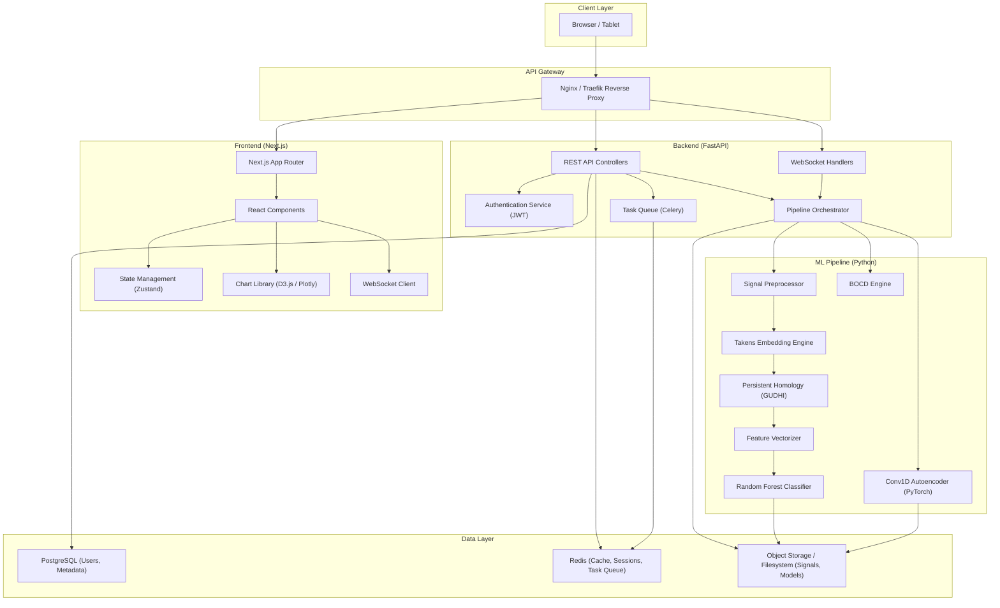
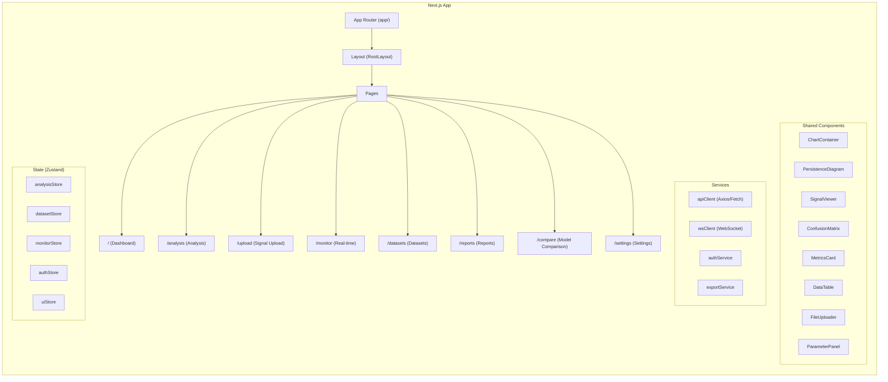
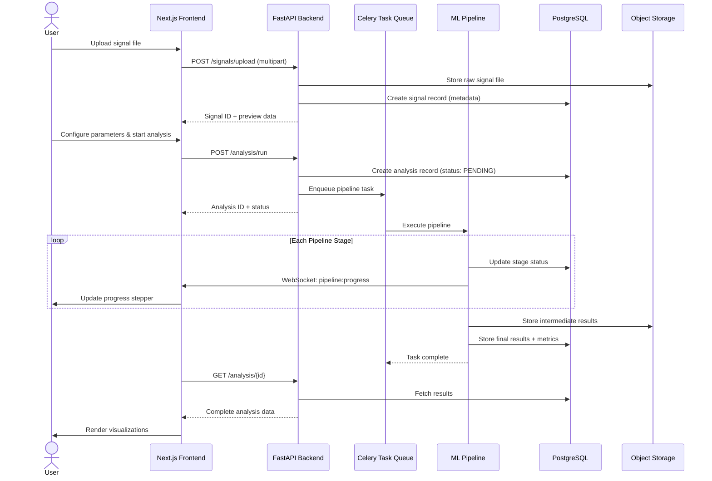
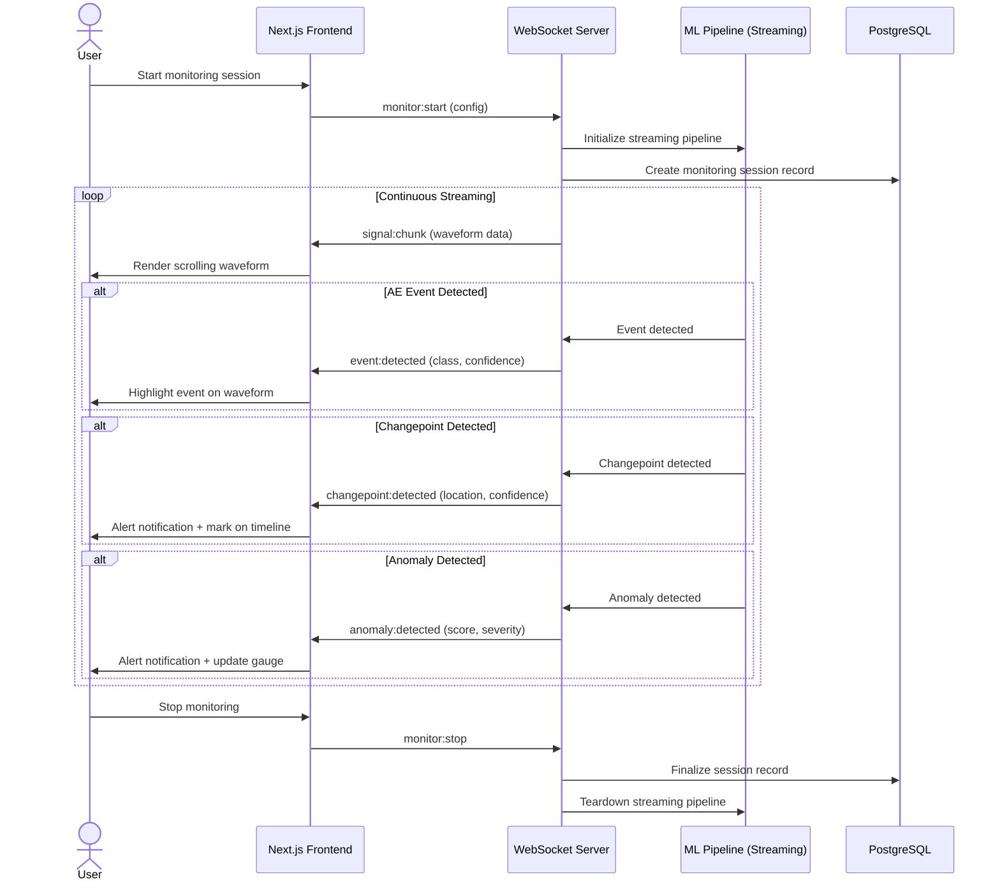
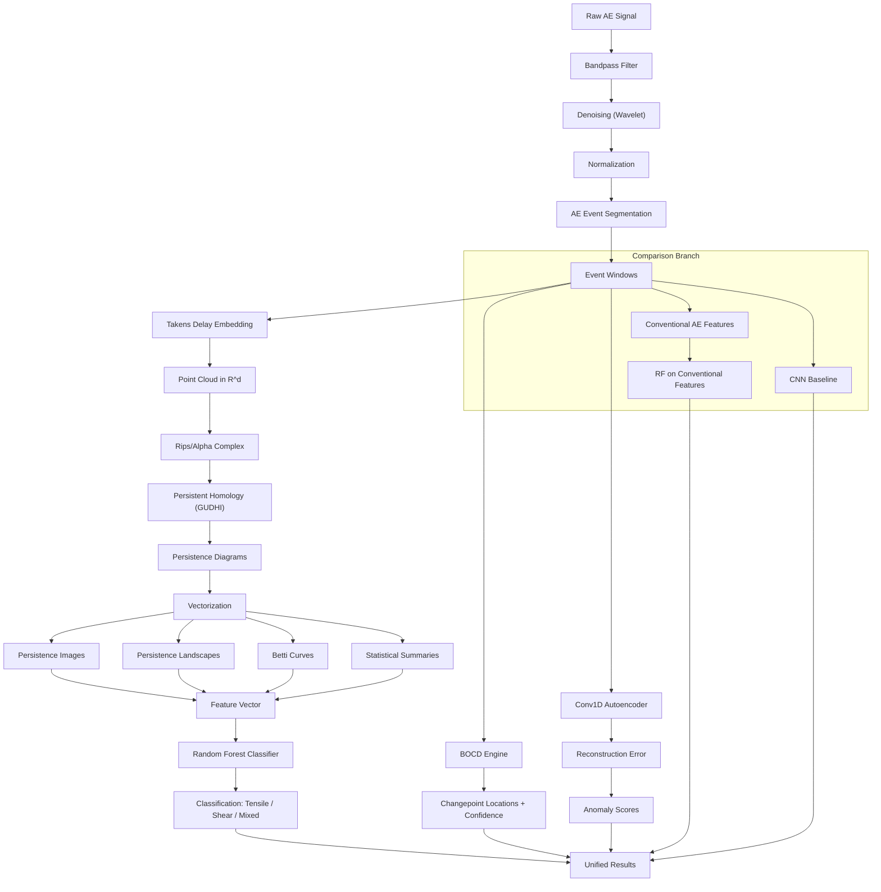

# Product Requirements Document (PRD)

## EchoSense Dashboard — Web Application

**Document Version:** 1.0.0
**Date:** November 1, 2026
**Authors:** EchoSense Research & Industrial Diagnostics Engineering Team
**Affiliation:** Autonomous Structural Health Monitoring & NDT Division
**Status:** Draft — Pending Review

---

## Table of Contents

1. [Executive Summary](#1-executive-summary)
2. [Problem Statement & Motivation](#2-problem-statement--motivation)
3. [Target Users](#3-target-users)
4. [Product Vision & Goals](#4-product-vision--goals)
5. [Functional Requirements](#5-functional-requirements)
6. [Non-Functional Requirements](#6-non-functional-requirements)
7. [System Architecture](#7-system-architecture)
8. [API Specifications](#8-api-specifications)
9. [UI/UX Requirements](#9-uiux-requirements)
10. [Data Flow Diagrams](#10-data-flow-diagrams)
11. [Success Metrics & KPIs](#11-success-metrics--kpis)
12. [Risks & Mitigations](#12-risks--mitigations)
13. [Out of Scope](#13-out-of-scope)
14. [Glossary](#14-glossary)

---

## 1. Executive Summary

**EchoSense Dashboard** is a Next.js web application that serves as the interactive frontend for the EchoSense framework — a topological machine learning system for structural damage precursor detection from smartphone-recorded acoustic emission (AE) signals. The dashboard enables researchers, structural engineers, field inspectors, and students to upload raw AE signals, visualize every stage of the topological ML pipeline, inspect classification and anomaly detection results, compare models, and generate exportable reports.

The application connects to a Python FastAPI backend that orchestrates the full ML pipeline: signal preprocessing, Takens delay-coordinate embedding, persistent homology computation, topological feature vectorization, Random Forest classification, Bayesian Online Changepoint Detection (BOCD), and Conv1D Autoencoder anomaly validation.

> [!IMPORTANT]
> This PRD covers the **frontend web application** and its integration contract with the backend. The ML pipeline itself is documented separately. This document defines what the dashboard must do, how it should look, and the API surface it consumes.

---

## 2. Problem Statement & Motivation

### 2.1 The Engineering Problem

Structural health monitoring (SHM) of civil and mechanical infrastructure — bridges, girders, concrete elements — traditionally relies on expensive, laboratory-grade acoustic emission sensors and proprietary software. Early damage precursors (micro-cracks, delamination onset, fiber breakage) emit transient elastic waves that, if detected early, can prevent catastrophic failures. However:

- **High equipment cost** limits deployment to critical structures only.
- **Expert-only workflows** prevent field inspectors from running analyses.
- **Opaque ML pipelines** make it difficult for engineers to trust or interpret results.
- **No unified visualization** exists for topological features (persistence diagrams, Betti curves) alongside conventional AE parameters.

### 2.2 The Product Problem

The EchoSense ML framework currently exists as a collection of Python scripts and Jupyter notebooks. There is **no interactive interface** for:

- Uploading and managing AE signal datasets
- Visualizing intermediate pipeline stages (embeddings, persistence diagrams)
- Comparing topological vs. conventional vs. deep learning approaches side-by-side
- Monitoring structures in real-time with changepoint alerts
- Generating audit-ready reports for structural assessment

### 2.3 Motivation

| Factor | Impact |
|---|---|
| Smartphone-based AE acquisition is emerging | Democratizes SHM — the dashboard must match this accessibility |
| Topological features are mathematically rich but visually unintuitive | Interactive visualization is essential for adoption |
| Regulatory compliance requires documented assessments | Automated report generation saves hours per inspection |
| Research reproducibility demands transparent pipelines | Step-by-step visualization enables verification |

---

## 3. Target Users

### 3.1 User Personas

| Persona | Role | Key Needs | Technical Level |
|---|---|---|---|
| **Dr. Ananya Sharma** | Structural Engineering Researcher | Compare topological vs. conventional features; publish reproducible results; export high-resolution figures | High (Python, ML basics) |
| **Rajesh Patel** | Field Structural Inspector | Upload smartphone recordings on-site; get quick pass/fail damage assessments; generate PDF reports for clients | Low–Medium (uses apps, no coding) |
| **Prof. Kenji Tanaka** | Civil Engineering Faculty | Demonstrate TDA concepts to students; use as a teaching tool for SHM courses | Medium (understands theory, limited coding) |
| **Maria Costa** | Bridge Maintenance Engineer | Monitor multiple structures over time; receive alerts on anomaly detection; track degradation trends | Medium (engineering software user) |
| **Alex Chen** | Graduate Research Student | Experiment with pipeline parameters; understand each stage; compare against baselines for thesis work | High (Python, ML proficient) |

### 3.2 User Access Levels

| Role | Permissions |
|---|---|
| **Admin** | Full access; user management; system configuration; dataset management |
| **Researcher** | Upload data; run full pipeline; export results; manage own datasets |
| **Inspector** | Upload data; run analysis; view results; generate reports |
| **Viewer** | Read-only access to shared results and reports |

---

## 4. Product Vision & Goals

### 4.1 Vision Statement

> *Make topological structural health monitoring accessible, interpretable, and actionable — from smartphone recording to engineering decision — through a single, intuitive web interface.*

### 4.2 Product Goals

| ID | Goal | Success Criterion |
|---|---|---|
| **G-01** | Provide end-to-end pipeline visualization | Every pipeline stage (raw signal → classification) is visually inspectable |
| **G-02** | Enable non-expert usage | A field inspector can upload a recording and get a damage assessment in < 5 clicks |
| **G-03** | Support research workflows | Parameter tuning, model comparison, and figure export are first-class features |
| **G-04** | Ensure real-time monitoring capability | Live AE streams can be processed with < 2 s latency for changepoint detection |
| **G-05** | Deliver production-grade reliability | 99.5% uptime; graceful error handling; no data loss |
| **G-06** | Maintain security and compliance | Authentication, role-based access, audit logging, encrypted data at rest and in transit |

### 4.3 Design Principles

1. **Progressive Disclosure** — Simple overview first; detailed analysis on demand
2. **Visual-First** — Every numerical result has a corresponding visualization
3. **Transparent Pipeline** — Users can inspect any intermediate stage
4. **Export Everything** — Any chart, table, or report can be exported
5. **Responsive & Accessible** — Works on tablets for field use; meets WCAG 2.1 AA

---

## 5. Functional Requirements

### 5.1 Dashboard & Overview

| ID | Requirement | Priority | Acceptance Criteria |
|---|---|---|---|
| **FR-001** | System status dashboard showing pipeline health, recent analyses, and active monitoring sessions | P0 | Dashboard loads within 2 s; shows last 10 analyses |
| **FR-002** | Summary statistics cards: total analyses run, active monitors, datasets loaded, alerts triggered | P0 | Cards update in real-time via WebSocket |
| **FR-003** | Quick-action buttons: "New Analysis", "Upload Signal", "Start Monitor", "View Reports" | P0 | Each button navigates to the correct workflow |
| **FR-004** | Recent activity feed with timestamps, user actions, and pipeline completion statuses | P1 | Feed shows last 50 events; filterable by type |
| **FR-005** | Notification center for pipeline completions, anomaly alerts, and system messages | P1 | Unread count badge; click-to-dismiss; persistent storage |

### 5.2 Signal Upload & Processing

| ID | Requirement | Priority | Acceptance Criteria |
|---|---|---|---|
| **FR-006** | Upload raw AE signal files (WAV, CSV, HDF5, NumPy `.npy`) via drag-and-drop or file picker | P0 | Files up to 500 MB accepted; progress bar shown; validates format before upload |
| **FR-007** | Batch upload of multiple signal files with automatic metadata extraction | P1 | Upload queue with individual progress; metadata table auto-populated |
| **FR-008** | Signal preview: waveform plot, spectrogram, basic statistics (duration, sampling rate, RMS, peak amplitude) | P0 | Preview renders within 1 s for signals up to 60 s at 44.1 kHz |
| **FR-009** | Preprocessing configuration panel: bandpass filter (frequency range), denoising method, normalization, segmentation window size | P0 | Form validates ranges; defaults pre-populated; "Reset to Defaults" button |
| **FR-010** | AE event segmentation visualization: original signal with detected event boundaries highlighted | P0 | Events marked with colored regions; click event to zoom; event count displayed |
| **FR-011** | Preprocessed signal comparison: overlay raw vs. filtered vs. segmented signals | P1 | Toggle layers on/off; synchronized zoom/pan across overlays |
| **FR-012** | Preprocessing parameter history: track which parameters were used for each analysis | P1 | Parameters stored with analysis; viewable in analysis detail page |

### 5.3 Takens Embedding Visualization

| ID | Requirement | Priority | Acceptance Criteria |
|---|---|---|---|
| **FR-013** | 2D/3D interactive scatter plot of Takens delay-coordinate embedding for each AE event | P0 | 3D view with orbit/pan/zoom; 2D projection toggle; renders < 2 s for 10,000 points |
| **FR-014** | Configurable embedding parameters: embedding dimension (d), time delay (τ), with real-time preview | P0 | Sliders update visualization within 500 ms; valid ranges enforced |
| **FR-015** | Optimal parameter estimation display: show results of mutual information (for τ) and false nearest neighbors (for d) | P1 | Plots of MI vs. τ and FNN% vs. d with recommended values highlighted |
| **FR-016** | Attractor comparison: side-by-side embedding of healthy vs. damaged signals | P1 | Synchronized camera controls; color-coded by class label |
| **FR-017** | Export embedding coordinates as CSV or NumPy array | P2 | Download button; includes metadata header |

### 5.4 Persistent Homology & Persistence Diagram Visualization

| ID | Requirement | Priority | Acceptance Criteria |
|---|---|---|---|
| **FR-018** | Interactive persistence diagram (birth vs. death plot) for H₀ (connected components) and H₁ (loops) | P0 | Points are hoverable with (birth, death, persistence) tooltip; color-coded by homology dimension |
| **FR-019** | Persistence barcode visualization (horizontal bars representing feature lifetimes) | P0 | Bars sorted by persistence; filterable by dimension; click to highlight corresponding diagram point |
| **FR-020** | Betti curve plot (Betti number as function of filtration parameter) | P1 | Smooth curve with confidence band if multiple events are aggregated |
| **FR-021** | Persistence landscape visualization | P1 | Layered plot with adjustable number of landscape functions (k = 1, 2, …, n) |
| **FR-022** | Filtration animation: step-by-step Rips/Alpha complex construction overlaid on point cloud | P1 | Play/pause/step controls; filtration parameter slider; complex rendered in real-time |
| **FR-023** | Topological feature summary table: number of H₀/H₁ features, max persistence, total persistence, persistence entropy | P0 | Table with sortable columns; exportable as CSV |
| **FR-024** | Comparison mode: overlay persistence diagrams from multiple events or classes | P1 | Legend with class labels; toggle individual diagrams on/off |
| **FR-025** | Bottleneck and Wasserstein distance computation between selected persistence diagrams | P2 | Distance value displayed; optimal matching visualized with connecting lines |

### 5.5 Random Forest Classification Results

| ID | Requirement | Priority | Acceptance Criteria |
|---|---|---|---|
| **FR-026** | Classification result display: predicted class (tensile, shear, mixed-mode), confidence score, top-3 predictions | P0 | Result card with color-coded class label; confidence bar chart |
| **FR-027** | Confusion matrix heatmap with absolute counts and percentages | P0 | Interactive cells showing true/predicted pairs; row/column normalization toggle |
| **FR-028** | ROC curve (per-class and macro/micro average) with AUC values | P0 | Interactive legend; hover for threshold at each point; AUC in legend |
| **FR-029** | Precision-Recall curve with PR-AUC values | P0 | Per-class curves; average curve; AUC values in legend |
| **FR-030** | Feature importance ranking: bar chart of topological features ranked by Gini importance | P1 | Horizontal bar chart; hover for exact importance value; top-N filter slider |
| **FR-031** | Classification report table: per-class precision, recall, F1-score, support | P0 | Sortable columns; macro/weighted averages in footer row |
| **FR-032** | Decision boundary visualization (2D t-SNE/UMAP projection of feature space with decision boundaries) | P2 | Configurable perplexity/n_neighbors; class-colored scatter; boundary contours |
| **FR-033** | Batch classification: run classifier on multiple events and display aggregate results | P1 | Progress bar; results table with per-event predictions; export as CSV |

### 5.6 Bayesian Changepoint Detection Visualization

| ID | Requirement | Priority | Acceptance Criteria |
|---|---|---|---|
| **FR-034** | Time-series plot with detected changepoints marked as vertical lines/bands | P0 | Signal plotted with time axis; changepoints shown as dashed red lines with confidence bands |
| **FR-035** | Run-length posterior probability heatmap over time | P0 | Color-mapped heatmap with time on x-axis, run length on y-axis; adjustable color scale |
| **FR-036** | Changepoint probability curve: P(changepoint) at each time step | P1 | Threshold line adjustable via slider; detected points highlighted |
| **FR-037** | Configurable BOCD parameters: hazard function (constant rate λ), observation model, prior parameters | P1 | Form with validated inputs; live preview of prior distributions |
| **FR-038** | Changepoint event log: table of detected changepoints with timestamps, confidence, and segment statistics | P0 | Sortable table; click row to navigate to that time point in the signal view |
| **FR-039** | Multi-channel changepoint alignment: show changepoints from multiple signals on a unified timeline | P2 | Gantt-chart style visualization; per-channel rows; aligned time axis |

### 5.7 Autoencoder Anomaly Detection

| ID | Requirement | Priority | Acceptance Criteria |
|---|---|---|---|
| **FR-040** | Reconstruction error time-series plot with anomaly threshold line | P0 | Error plotted per-event or per-window; threshold adjustable; anomalies highlighted in red |
| **FR-041** | Input vs. reconstructed signal overlay for selected events | P0 | Dual-axis or overlaid plot; residual plot below; synchronized zoom |
| **FR-042** | Anomaly score distribution (histogram/KDE) for normal vs. anomalous events | P1 | Overlapping distributions with threshold marker; counts in legend |
| **FR-043** | Latent space visualization: 2D projection (t-SNE/UMAP) of autoencoder bottleneck activations | P1 | Color-coded by class or anomaly label; click point to inspect event |
| **FR-044** | Training loss curves: training vs. validation loss over epochs | P1 | Dual-line plot; hover for exact values; early stopping point marked |
| **FR-045** | Anomaly detection summary: count of anomalies, percentage, severity distribution | P0 | Summary cards; severity histogram (low/medium/high based on reconstruction error quantiles) |

### 5.8 Model Comparison View

| ID | Requirement | Priority | Acceptance Criteria |
|---|---|---|---|
| **FR-046** | Side-by-side comparison table: EchoSense (topological RF) vs. Conventional AE features (RF) vs. CNN baseline | P0 | Table with rows for each metric; columns for each model; best values highlighted in bold/green |
| **FR-047** | Comparative ROC curves: all three models on the same plot | P0 | Distinct line styles; AUC in legend; diagonal reference line |
| **FR-048** | Comparative confusion matrices: triptych layout | P1 | Three matrices side by side; same color scale; difference matrix option |
| **FR-049** | Radar/spider chart comparing models across multiple metrics (accuracy, precision, recall, F1, AUC) | P1 | Interactive hover; toggle models on/off |
| **FR-050** | Statistical significance testing results: McNemar's test or similar between model pairs | P2 | p-values displayed; significance indicated with symbols (*, **, ***) |
| **FR-051** | Computational cost comparison: training time, inference time, model size, memory usage | P2 | Bar chart with grouped bars per model; exact values in tooltip |

### 5.9 Real-time Monitoring Mode

| ID | Requirement | Priority | Acceptance Criteria |
|---|---|---|---|
| **FR-052** | Live signal streaming interface: connect to a smartphone or audio input source via WebSocket | P1 | Connection status indicator; latency display; buffer size config |
| **FR-053** | Real-time waveform display with scrolling window | P1 | Configurable window size (5 s, 10 s, 30 s, 60 s); smooth rendering at 30+ fps |
| **FR-054** | Live AE event detection with instant classification overlay | P1 | Detected events highlighted in stream; class label appears within 2 s of detection |
| **FR-055** | Live changepoint detection alerts with configurable notification (in-app, email, webhook) | P1 | Alert appears within 2 s of changepoint; notification channel configurable per monitor |
| **FR-056** | Monitoring session management: start/stop/pause; session history; session comparison | P1 | Sessions persisted with full data; resumable; comparison view |
| **FR-057** | Multi-sensor dashboard: monitor multiple sources simultaneously in a grid layout | P2 | 2×2 or 3×3 grid; per-cell status; expandable to full view |

### 5.10 Report Generation & Export

| ID | Requirement | Priority | Acceptance Criteria |
|---|---|---|---|
| **FR-058** | Automated structural assessment report (PDF) with all pipeline stages, results, and recommendations | P0 | Professional template; includes all visualizations; generated within 30 s |
| **FR-059** | Customizable report builder: select which sections/charts to include | P1 | Drag-and-drop section ordering; preview before export; save templates |
| **FR-060** | Export individual charts as PNG (300 DPI), SVG, or interactive HTML | P0 | Right-click or toolbar button on any chart; resolution configurable for PNG |
| **FR-061** | Export raw data and results as CSV, JSON, or HDF5 | P1 | Column selection; metadata included; large exports handled asynchronously with download link |
| **FR-062** | Shareable analysis links: generate a read-only URL for a completed analysis | P2 | Link includes authentication token; configurable expiry (1 h, 24 h, 7 d, never) |
| **FR-063** | Analysis comparison report: generate a document comparing two or more analyses | P2 | Delta highlighting; statistical comparison; side-by-side charts |

### 5.11 Dataset Management

| ID | Requirement | Priority | Acceptance Criteria |
|---|---|---|---|
| **FR-064** | Dataset library: list all uploaded datasets with metadata (name, source, size, date, event count, labels) | P0 | Searchable, sortable table; pagination for large collections |
| **FR-065** | Built-in datasets: pre-loaded Prestressed RC Bridge-Girder AE Dataset and Concrete AE Event Dataset | P0 | Available without upload; documentation links; citation info displayed |
| **FR-066** | Dataset versioning: track changes to datasets (additions, label corrections) | P2 | Version history; diff view; rollback capability |
| **FR-067** | Dataset statistics page: class distribution, signal duration distribution, sampling rate info, event count by label | P1 | Auto-generated on upload; charts and summary table |
| **FR-068** | Dataset splitting configuration: train/validation/test split ratios; stratified splitting; seed control | P1 | Visual split preview; class balance verification; reproducible with seed |
| **FR-069** | Dataset tagging and organization: assign tags, categories, and notes to datasets | P2 | Tag autocomplete; filter by tags; bulk operations |

### 5.12 User Authentication & Management

| ID | Requirement | Priority | Acceptance Criteria |
|---|---|---|---|
| **FR-070** | User registration and login with email/password | P0 | Password strength requirements; email verification; secure password hashing (bcrypt/argon2) |
| **FR-071** | OAuth 2.0 / SSO login (Google, GitHub, institutional SSO) | P1 | Redirect flow; account linking; first-login profile completion |
| **FR-072** | Role-based access control (RBAC) as defined in §3.2 | P0 | Permissions enforced on both frontend routes and API endpoints |
| **FR-073** | User profile management: display name, affiliation, notification preferences | P1 | Self-service profile editing; avatar upload; email change with re-verification |
| **FR-074** | Audit log: record user actions (login, upload, analysis run, export) with timestamps | P1 | Admin-viewable; filterable by user, action type, date range; exportable |
| **FR-075** | API key management: generate/revoke API keys for programmatic access | P2 | Scoped permissions per key; expiry configuration; usage stats |

---

## 6. Non-Functional Requirements

### 6.1 Performance

| ID | Requirement | Target | Measurement |
|---|---|---|---|
| **NFR-001** | Dashboard initial load time | < 2 s (LCP) | Lighthouse CI on 4G throttled connection |
| **NFR-002** | API response time (non-pipeline endpoints) | < 200 ms (p95) | Server-side latency logging |
| **NFR-003** | Pipeline execution feedback | Progress updates every 2 s | WebSocket message interval |
| **NFR-004** | Chart rendering (< 10,000 points) | < 500 ms | Client-side performance mark |
| **NFR-005** | Chart rendering (10,000–100,000 points) | < 2 s with WebGL fallback | Client-side performance mark |
| **NFR-006** | File upload throughput | ≥ 10 MB/s on local network | Network transfer measurement |
| **NFR-007** | Concurrent users supported | ≥ 50 simultaneous | Load testing with k6 or Locust |
| **NFR-008** | Real-time monitoring latency (end-to-end) | < 2 s from signal to alert | Timestamp comparison |

### 6.2 Security

| ID | Requirement | Details |
|---|---|---|
| **NFR-009** | Transport encryption | TLS 1.3 for all client-server communication |
| **NFR-010** | Data at rest encryption | AES-256 for stored signals and analysis results |
| **NFR-011** | Authentication tokens | JWT with short-lived access tokens (15 min) and refresh tokens (7 d) |
| **NFR-012** | Input validation | Server-side validation on all API inputs; file type verification; size limits |
| **NFR-013** | CSRF protection | SameSite cookies; CSRF tokens for state-changing requests |
| **NFR-014** | Rate limiting | 100 req/min per user for API; 10 req/min for auth endpoints |
| **NFR-015** | Dependency scanning | Automated CVE scanning in CI/CD; no known critical vulnerabilities in production |

### 6.3 Accessibility

| ID | Requirement | Standard |
|---|---|---|
| **NFR-016** | WCAG 2.1 Level AA compliance | All interactive elements keyboard-navigable; ARIA labels on charts |
| **NFR-017** | Color-blind safe palettes | All visualizations use distinguishable palettes (e.g., Okabe-Ito); pattern fills as fallback |
| **NFR-018** | Screen reader support | Semantic HTML; alt text for charts; data tables as chart alternatives |
| **NFR-019** | Responsive design | Fully functional on screens ≥ 768 px width; degraded gracefully on smaller |

### 6.4 Scalability & Reliability

| ID | Requirement | Target |
|---|---|---|
| **NFR-020** | Uptime | 99.5% monthly (excluding planned maintenance) |
| **NFR-021** | Horizontal scaling | Stateless frontend; backend scales behind load balancer |
| **NFR-022** | Data retention | Analysis results retained for 1 year; configurable per deployment |
| **NFR-023** | Backup & recovery | Daily automated backups; RPO < 24 h; RTO < 4 h |
| **NFR-024** | Graceful degradation | If ML backend is down, dashboard shows cached results and clear error state |

### 6.5 Maintainability

| ID | Requirement | Details |
|---|---|---|
| **NFR-025** | Code coverage | ≥ 80% for frontend unit tests; ≥ 70% for integration tests |
| **NFR-026** | Documentation | JSDoc on all exported functions; Storybook for UI components |
| **NFR-027** | Linting & formatting | ESLint + Prettier enforced in CI; zero lint errors in main branch |
| **NFR-028** | Containerized deployment | Docker Compose for development; Kubernetes-ready Helm charts for production |

---

## 7. System Architecture

### 7.1 High-Level Architecture



### 7.2 Frontend Architecture



### 7.3 Technology Stack

| Layer | Technology | Justification |
|---|---|---|
| **Framework** | Next.js 14+ (App Router) | SSR for SEO; API routes for BFF pattern; React Server Components for performance |
| **Language** | TypeScript 5.x | Type safety; better DX; catch errors at compile time |
| **Styling** | Tailwind CSS + shadcn/ui | Rapid UI development; consistent design system; accessible components |
| **Charts** | Plotly.js (primary) + D3.js (custom) | Plotly for standard scientific charts; D3 for custom TDA visualizations |
| **3D Rendering** | Three.js / React Three Fiber | Takens embedding 3D scatter plots; persistence diagram 3D views |
| **State Management** | Zustand | Lightweight; TypeScript-native; minimal boilerplate |
| **Data Fetching** | TanStack Query (React Query) | Caching; background refetch; optimistic updates; pagination |
| **Forms** | React Hook Form + Zod | Performant form handling; schema-based validation |
| **Real-time** | Socket.IO client | WebSocket abstraction; auto-reconnect; fallback to polling |
| **Testing** | Vitest + React Testing Library + Playwright | Unit + integration + E2E coverage |
| **Backend** | FastAPI (Python 3.11+) | Async support; auto-generated OpenAPI docs; Pydantic validation |
| **Task Queue** | Celery + Redis | Async pipeline execution; progress tracking; result caching |
| **Database** | PostgreSQL 15+ | Relational data; JSON columns for flexible metadata |
| **Cache / Broker** | Redis 7+ | Session store; Celery broker; response caching |
| **File Storage** | S3-compatible (MinIO for dev / S3 for prod) | Scalable object storage for large signal files and models |
| **Containerization** | Docker + Docker Compose | Reproducible environments; easy local development |

---

## 8. API Specifications

### 8.1 Base URL & Versioning

- **Base URL:** `https://<host>/api/v1`
- **Versioning:** URI path versioning (`/api/v1/`, `/api/v2/`)
- **Format:** JSON (request and response bodies)
- **Authentication:** Bearer token (JWT) in `Authorization` header

### 8.2 Core Endpoints

#### 8.2.1 Authentication

| Method | Endpoint | Description | Auth |
|---|---|---|---|
| `POST` | `/auth/register` | Register a new user | Public |
| `POST` | `/auth/login` | Login, receive JWT tokens | Public |
| `POST` | `/auth/refresh` | Refresh access token | Refresh token |
| `POST` | `/auth/logout` | Invalidate refresh token | Bearer |
| `GET` | `/auth/me` | Get current user profile | Bearer |

#### 8.2.2 Signals

| Method | Endpoint | Description | Auth |
|---|---|---|---|
| `POST` | `/signals/upload` | Upload a signal file (multipart/form-data) | Bearer |
| `GET` | `/signals` | List uploaded signals (paginated) | Bearer |
| `GET` | `/signals/{id}` | Get signal metadata and preview data | Bearer |
| `DELETE` | `/signals/{id}` | Delete a signal | Bearer |
| `GET` | `/signals/{id}/waveform` | Get downsampled waveform data for plotting | Bearer |
| `GET` | `/signals/{id}/spectrogram` | Get spectrogram data | Bearer |

#### 8.2.3 Analysis Pipeline

| Method | Endpoint | Description | Auth |
|---|---|---|---|
| `POST` | `/analysis/run` | Start a full pipeline analysis (async) | Bearer |
| `GET` | `/analysis` | List analyses (paginated, filterable) | Bearer |
| `GET` | `/analysis/{id}` | Get analysis results and status | Bearer |
| `DELETE` | `/analysis/{id}` | Delete an analysis | Bearer |
| `GET` | `/analysis/{id}/status` | Get pipeline stage progress | Bearer |

**Request body for `POST /analysis/run`:**

```json
{
  "signal_id": "uuid",
  "preprocessing": {
    "bandpass_low": 20000,
    "bandpass_high": 400000,
    "denoising": "wavelet",
    "normalization": "z-score",
    "segmentation_window_ms": 50
  },
  "takens": {
    "embedding_dim": 3,
    "time_delay": 5,
    "auto_optimize": true
  },
  "homology": {
    "max_dimension": 2,
    "max_edge_length": 2.0,
    "complex_type": "rips"
  },
  "classification": {
    "model": "random_forest",
    "n_estimators": 200,
    "max_depth": 15
  },
  "bocd": {
    "hazard_rate": 250,
    "observation_model": "gaussian"
  },
  "autoencoder": {
    "latent_dim": 16,
    "epochs": 50,
    "anomaly_threshold_percentile": 95
  }
}
```

#### 8.2.4 Pipeline Stage Results

| Method | Endpoint | Description | Auth |
|---|---|---|---|
| `GET` | `/analysis/{id}/preprocessing` | Preprocessed signal data and event boundaries | Bearer |
| `GET` | `/analysis/{id}/embedding` | Takens embedding coordinates | Bearer |
| `GET` | `/analysis/{id}/homology` | Persistence diagrams, barcodes, Betti curves | Bearer |
| `GET` | `/analysis/{id}/classification` | RF predictions, metrics, feature importance | Bearer |
| `GET` | `/analysis/{id}/changepoints` | BOCD results, changepoint locations, run-length posterior | Bearer |
| `GET` | `/analysis/{id}/anomalies` | Autoencoder reconstruction errors, anomaly scores | Bearer |
| `GET` | `/analysis/{id}/comparison` | Comparative metrics (Topo vs. Conventional vs. CNN) | Bearer |

#### 8.2.5 Datasets

| Method | Endpoint | Description | Auth |
|---|---|---|---|
| `GET` | `/datasets` | List available datasets | Bearer |
| `GET` | `/datasets/{id}` | Get dataset details and statistics | Bearer |
| `POST` | `/datasets` | Create a new dataset from uploaded signals | Bearer |
| `PUT` | `/datasets/{id}` | Update dataset metadata | Bearer |
| `DELETE` | `/datasets/{id}` | Delete a dataset | Bearer (Admin) |
| `GET` | `/datasets/{id}/statistics` | Get class distribution, signal stats | Bearer |
| `POST` | `/datasets/{id}/split` | Configure train/val/test split | Bearer |

#### 8.2.6 Reports

| Method | Endpoint | Description | Auth |
|---|---|---|---|
| `POST` | `/reports/generate` | Generate a PDF report for an analysis | Bearer |
| `GET` | `/reports` | List generated reports | Bearer |
| `GET` | `/reports/{id}/download` | Download report file | Bearer |

#### 8.2.7 Real-time Monitoring (WebSocket)

| Event | Direction | Description |
|---|---|---|
| `monitor:start` | Client → Server | Start monitoring session with config |
| `monitor:stop` | Client → Server | Stop monitoring session |
| `signal:chunk` | Server → Client | Streaming signal data chunk |
| `event:detected` | Server → Client | AE event detected with classification |
| `changepoint:detected` | Server → Client | Changepoint alert with confidence |
| `anomaly:detected` | Server → Client | Anomaly detected with severity |
| `pipeline:progress` | Server → Client | Pipeline stage completion updates |
| `error` | Server → Client | Error notification |

### 8.3 Response Format

**Success:**
```json
{
  "status": "success",
  "data": { ... },
  "meta": {
    "page": 1,
    "per_page": 20,
    "total": 150,
    "total_pages": 8
  }
}
```

**Error:**
```json
{
  "status": "error",
  "error": {
    "code": "VALIDATION_ERROR",
    "message": "Invalid bandpass frequency range",
    "details": [
      {
        "field": "preprocessing.bandpass_low",
        "message": "Must be less than bandpass_high"
      }
    ]
  }
}
```

---

## 9. UI/UX Requirements

### 9.1 Design System

| Element | Specification |
|---|---|
| **Color Palette (Light)** | Primary: `#1E40AF` (blue-800); Secondary: `#059669` (emerald-600); Danger: `#DC2626`; Warning: `#D97706`; Background: `#F8FAFC` |
| **Color Palette (Dark)** | Primary: `#60A5FA` (blue-400); Secondary: `#34D399`; Background: `#0F172A` (slate-900) |
| **Typography** | Headings: Inter (600/700); Body: Inter (400); Code/Data: JetBrains Mono |
| **Spacing** | 4 px grid system; consistent padding (16 px cards, 24 px sections) |
| **Border Radius** | Small: 4 px; Medium: 8 px; Large: 12 px |
| **Shadows** | Subtle elevation for cards; stronger for modals and dropdowns |
| **Icons** | Lucide Icons (consistent with shadcn/ui) |
| **Dark Mode** | System-preference detection; manual toggle; persistent preference |

### 9.2 Page-by-Page Wireframe Descriptions

#### 9.2.1 Dashboard (`/`)

```
┌──────────────────────────────────────────────────────────────────────┐
│  ┌─ Sidebar ─┐  ┌─ Header ─────────────────────────────────────┐   │
│  │ Logo      │  │ Search Bar        Notifications  User Avatar │   │
│  │ Dashboard │  └───────────────────────────────────────────────┘   │
│  │ Analysis  │  ┌─ Quick Actions ──────────────────────────────┐   │
│  │ Upload    │  │ [+ New Analysis] [↑ Upload] [📡 Monitor]    │   │
│  │ Monitor   │  └─────────────────────────────────────────────-┘   │
│  │ Datasets  │  ┌─ Stats Cards ────────────────────────────────┐   │
│  │ Reports   │  │ ┌─────────┐ ┌─────────┐ ┌─────────┐ ┌─────┐│   │
│  │ Compare   │  │ │Total    │ │Active   │ │Datasets │ │Alerts││   │
│  │ Settings  │  │ │Analyses │ │Monitors │ │Loaded   │ │Today ││   │
│  │           │  │ │  247    │ │   3     │ │  12     │ │  5   ││   │
│  │           │  │ └─────────┘ └─────────┘ └─────────┘ └─────┘│   │
│  │           │  └──────────────────────────────────────────────┘   │
│  │           │  ┌─ Recent Analyses ─────┐ ┌─ Activity Feed ───┐   │
│  │           │  │ Analysis table with   │ │ Time-stamped log  │   │
│  │           │  │ status, date, result  │ │ of user actions   │   │
│  │           │  │ badges, quick actions │ │ and system events  │   │
│  │           │  └───────────────────────┘ └────────────────────┘   │
│  └───────────┘                                                      │
└──────────────────────────────────────────────────────────────────────┘
```

- **Layout:** Collapsible sidebar (240 px expanded, 64 px collapsed) + main content area.
- **Stats Cards:** 4 key metrics; animated count-up on load; click navigates to detail.
- **Recent Analyses Table:** Last 10 analyses; columns: Name, Dataset, Status (badge), Date, F1 Score, Actions (view, delete).
- **Activity Feed:** Scrollable list; real-time updates via WebSocket.

#### 9.2.2 Signal Upload (`/upload`)

- **Drop Zone:** Large central area (dashed border, drag-over highlight) accepting WAV, CSV, HDF5, NPY.
- **Upload Queue:** Below drop zone; list of files with progress bars, file size, estimated time.
- **Signal Preview Panel:** Right side; auto-populated when a file is selected; shows waveform, spectrogram thumbnail, and basic stats table.
- **Metadata Form:** Below preview; fields for Dataset Name, Description, Labels, Sampling Rate (auto-detected), Notes.
- **Action Bar:** Bottom; "Start Analysis" (primary), "Save to Library" (secondary), "Cancel".

#### 9.2.3 Analysis View (`/analysis/{id}`)

- **Tab Navigation:** Horizontal tabs: Overview | Preprocessing | Embedding | Topology | Classification | Changepoints | Anomalies.
- **Overview Tab:** Pipeline status stepper (preprocessing → embedding → homology → classification → BOCD → autoencoder); summary metrics cards; key findings callout box.
- **Preprocessing Tab:** Waveform viewer with raw/filtered/segmented toggle; parameter sidebar; event boundary table.
- **Embedding Tab:** 3D scatter plot (full width, 500 px min height); parameter controls in sidebar; projection type selector (3D/2D).
- **Topology Tab:** Split view — persistence diagram (left) + barcode (right); dimension filter (H₀/H₁); summary stats below; Betti curve in collapsible section.
- **Classification Tab:** Result hero (predicted class with confidence); metrics grid (accuracy, precision, recall, F1); confusion matrix; ROC/PR curves; feature importance chart.
- **Changepoints Tab:** Full-width time series with changepoint markers; run-length heatmap below; event log table in collapsible section.
- **Anomalies Tab:** Reconstruction error plot; input vs. reconstructed overlay (selected event); anomaly summary cards; latent space visualization.

#### 9.2.4 Model Comparison (`/compare`)

- **Model Selector:** Multi-select dropdown to choose which models/analyses to compare (up to 4).
- **Metrics Dashboard:** Comparative table (rows = metrics, columns = models) with visual cell coloring (green = best).
- **Chart Section:** Tabbed — ROC Overlay | Confusion Matrices | Radar Chart | Computational Cost.
- **Export:** "Export Comparison Report" button.

#### 9.2.5 Real-time Monitor (`/monitor`)

- **Connection Panel:** Source selector (microphone input, WebSocket URL, file stream simulation); connection status LED (green/red/yellow).
- **Live Signal Viewer:** Scrolling waveform, full width; configurable window.
- **Detection Panel (below signal):** Three columns — Events Detected (count + recent list), Changepoints (timeline), Anomaly Score (gauge).
- **Alert Log:** Right sidebar; chronological; severity-coded (info/warning/critical).

#### 9.2.6 Dataset Management (`/datasets`)

- **Dataset Grid/List Toggle:** Card view (thumbnail, name, event count, date) or table view (sortable columns).
- **Dataset Detail Page:** (`/datasets/{id}`) — Statistics dashboard: class distribution pie/bar, signal duration histogram, sampling rate table; event browser with pagination; split configuration form.
- **Built-in Datasets:** Pinned cards at top with "Preloaded" badge and documentation links.

#### 9.2.7 Reports (`/reports`)

- **Report List:** Table with columns: Report Name, Analysis, Date Generated, Format, Size, Actions (download, share, delete).
- **Report Builder:** (`/reports/new`) — Step 1: Select analysis; Step 2: Choose sections (checkboxes); Step 3: Configure (title, author, notes); Step 4: Preview; Step 5: Generate.
- **Preview Mode:** In-app rendered preview of the PDF report.

#### 9.2.8 Settings (`/settings`)

- **Tabs:** Profile | Appearance | Notifications | API Keys | Admin (admin-only).
- **Appearance:** Theme toggle (light/dark/system); chart color palette selector; data table density.
- **Notifications:** Per-event-type toggles (in-app, email); quiet hours configuration.
- **Admin Tab:** User management table; system health metrics; storage usage.

---

## 10. Data Flow Diagrams

### 10.1 Signal Upload to Analysis Flow



### 10.2 Real-time Monitoring Flow



### 10.3 ML Pipeline Internal Flow



---

## 11. Success Metrics & KPIs

### 11.1 Product KPIs

| Metric | Target | Measurement Method | Review Cadence |
|---|---|---|---|
| **Time to First Analysis** | < 5 min from signup to first completed analysis | Funnel analytics (signup → upload → analysis complete) | Weekly |
| **Analysis Completion Rate** | > 95% of started analyses complete without error | Pipeline success/failure logs | Daily |
| **Mean Time to Classification** | < 30 s for a single event (non-queued) | Server-side pipeline timing | Weekly |
| **User Retention (7-day)** | > 60% of registered users return within 7 days | Login analytics | Weekly |
| **Report Generation Usage** | > 40% of completed analyses result in a report export | Report generation logs | Monthly |
| **Real-time Monitoring Adoption** | > 20% of active users try monitoring within first month | Feature usage tracking | Monthly |
| **Mean Time to Alert** | < 2 s from changepoint occurrence to user notification | End-to-end timestamp measurement | Weekly |

### 11.2 Technical KPIs

| Metric | Target | Measurement |
|---|---|---|
| **Frontend Core Web Vitals** | LCP < 2.5 s; FID < 100 ms; CLS < 0.1 | Lighthouse CI + RUM |
| **API Error Rate** | < 0.5% of requests return 5xx | Server logs |
| **API Latency (p95)** | < 500 ms for non-pipeline endpoints | Server metrics |
| **Uptime** | ≥ 99.5% monthly | Health check monitoring |
| **Test Coverage** | ≥ 80% frontend; ≥ 85% backend | CI coverage reports |
| **Build Time** | < 3 min for full CI pipeline | CI/CD metrics |
| **Bundle Size** | < 300 kB initial JS (gzipped) | Webpack analyzer |

### 11.3 ML Performance KPIs (displayed in dashboard)

| Metric | Baseline Target | Notes |
|---|---|---|
| **Classification Accuracy** | ≥ 92% on Concrete AE Event Dataset | Per the research targets |
| **Classification F1 (macro)** | ≥ 0.90 | Across tensile/shear/mixed |
| **ROC-AUC** | ≥ 0.96 | Per-class and macro |
| **Changepoint Detection Recall** | ≥ 0.85 | True changepoints captured |
| **Changepoint Detection Precision** | ≥ 0.80 | Minimize false alarms |
| **Mean Detection Delay** | < 500 ms | Time from true changepoint to detection |
| **Autoencoder Anomaly F1** | ≥ 0.85 | At optimal threshold |

---

## 12. Risks & Mitigations

| ID | Risk | Likelihood | Impact | Mitigation Strategy |
|---|---|---|---|---|
| **R-01** | Large signal files cause upload timeouts | Medium | High | Chunked upload with resumable uploads (tus protocol); client-side compression for WAV |
| **R-02** | GUDHI computation is slow for dense point clouds | High | Medium | Server-side subsampling; progress feedback; configurable max points; precomputed cache |
| **R-03** | WebSocket connections drop during real-time monitoring | Medium | High | Auto-reconnect with exponential backoff; buffered events; session recovery |
| **R-04** | Users misinterpret topological visualizations | High | Medium | Contextual tooltips; "What am I looking at?" help panels; guided tutorial mode |
| **R-05** | Concurrent pipeline executions exhaust compute resources | Medium | High | Queue-based execution with concurrency limits; priority queuing; resource monitoring |
| **R-06** | Browser memory exhaustion with large 3D point clouds | Medium | Medium | WebGL rendering with LOD; progressive loading; max point count warnings |
| **R-07** | Model drift — pretrained RF/Autoencoder degrades on new data distributions | Low | High | Display model training metadata; retraining workflow; confidence calibration warnings |
| **R-08** | Security vulnerabilities in file upload (malicious files) | Low | Critical | Server-side file validation; sandboxed processing; antivirus scanning; strict MIME type checks |
| **R-09** | Cross-browser 3D rendering inconsistencies | Medium | Low | WebGL feature detection; graceful fallback to 2D; tested browser matrix (Chrome, Firefox, Safari, Edge) |
| **R-10** | Scope creep delays MVP delivery | High | High | Strict priority tiers (P0 = MVP); two-week sprint cycles; feature flags for P1/P2 |

---

## 13. Out of Scope

The following items are **explicitly excluded** from this product version:

| Item | Rationale |
|---|---|
| **Mobile native app (iOS/Android)** | Responsive web app covers tablet use; native app is a future phase |
| **Raw sensor hardware integration** | The system consumes recorded files or audio streams; direct sensor protocol (e.g., IEPE) drivers are out of scope |
| **ML model training from the UI** | Users cannot retrain the RF, Autoencoder, or CNN from the dashboard; they use pre-trained models |
| **Multi-tenant SaaS deployment** | V1 targets single-organization deployment; multi-tenancy is future work |
| **Finite element analysis (FEA) integration** | No structural simulation; the system analyzes acoustic signals only |
| **Natural language query interface** | No chatbot or NLP-based querying of results |
| **Video/image-based structural inspection** | Only acoustic emission signals are processed; visual inspection tools are out of scope |
| **Regulatory certification (CE, ASTM)** | The tool aids analysis but does not replace certified inspection procedures |
| **Localization / i18n** | V1 is English-only; multi-language support is future work |
| **Offline/PWA mode** | Requires server connectivity for ML inference; offline caching of results is future consideration |

---

## 14. Glossary

| Term | Definition |
|---|---|
| **Acoustic Emission (AE)** | Transient elastic waves generated by the rapid release of energy from localized sources within a material (e.g., crack propagation, delamination) |
| **Takens Delay Embedding** | A mathematical technique to reconstruct a dynamical system's state space from a single time series by creating vectors of time-delayed copies: x(t) → [x(t), x(t−τ), x(t−2τ), …, x(t−(d−1)τ)] |
| **Persistent Homology** | A method from Topological Data Analysis (TDA) that studies the topological features (connected components, loops, voids) of data across multiple scales, recording when features are "born" and when they "die" |
| **Persistence Diagram** | A 2D scatter plot where each point (b, d) represents a topological feature born at filtration value b and dying at filtration value d; points far from the diagonal represent significant features |
| **Betti Number** | A topological invariant: β₀ counts connected components, β₁ counts loops/tunnels, β₂ counts voids/cavities |
| **Persistence Barcode** | An alternative representation of persistent homology where each feature is drawn as a horizontal bar spanning from its birth to death filtration value |
| **Persistence Landscape** | A functional summary of persistence diagrams that enables statistical operations (mean, variance) in a Banach space |
| **Rips Complex (Vietoris-Rips)** | A simplicial complex constructed by connecting all points within a distance threshold ε; used as the filtration in persistent homology |
| **GUDHI** | Geometry Understanding in Higher Dimensions — a C++/Python library for computational topology and TDA |
| **Random Forest (RF)** | An ensemble ML classifier that aggregates predictions from multiple decision trees trained on bootstrapped subsets of data |
| **BOCD** | Bayesian Online Changepoint Detection — a probabilistic algorithm that detects abrupt changes in the generative parameters of sequential data in an online (streaming) fashion |
| **Conv1D Autoencoder** | A neural network architecture using 1D convolutional layers that learns to compress (encode) and reconstruct (decode) time-series signals; high reconstruction error indicates anomalies |
| **ROC-AUC** | Area Under the Receiver Operating Characteristic curve — measures classifier performance across all discrimination thresholds (1.0 = perfect) |
| **PR-AUC** | Area Under the Precision-Recall curve — especially useful for imbalanced classification problems |
| **F1-Score** | Harmonic mean of precision and recall; balances false positives and false negatives |
| **Confusion Matrix** | A table showing predicted vs. actual class labels; visualizes classification errors |
| **t-SNE** | t-distributed Stochastic Neighbor Embedding — a dimensionality reduction technique for visualizing high-dimensional data in 2D/3D |
| **UMAP** | Uniform Manifold Approximation and Projection — a dimensionality reduction algorithm that preserves both local and global data structure |
| **SHM** | Structural Health Monitoring — the process of implementing a damage detection strategy for engineering structures |
| **Precursor** | An early indicator of developing structural damage, detected before visible failure |
| **LCP** | Largest Contentful Paint — a Core Web Vital measuring perceived load speed |
| **FID** | First Input Delay — a Core Web Vital measuring interactivity responsiveness |
| **CLS** | Cumulative Layout Shift — a Core Web Vital measuring visual stability |
| **JWT** | JSON Web Token — a compact, URL-safe means of representing authentication claims |
| **BFF** | Backend For Frontend — an architectural pattern where the frontend has its own dedicated backend API layer |
| **SSR** | Server-Side Rendering — rendering web pages on the server before sending HTML to the client |

---

> [!NOTE]
> **Document Revision History**
>
> | Version | Date | Author | Changes |
> |---|---|---|---|
> | 1.0.0 | 2026-11-01 | EchoSense Engineering Team | Initial PRD draft |

---

*This document is a living artifact and will be updated as requirements evolve through stakeholder feedback, technical discovery, and iterative development.*
